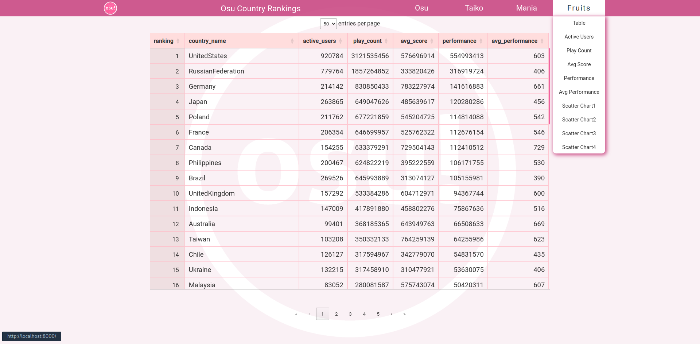
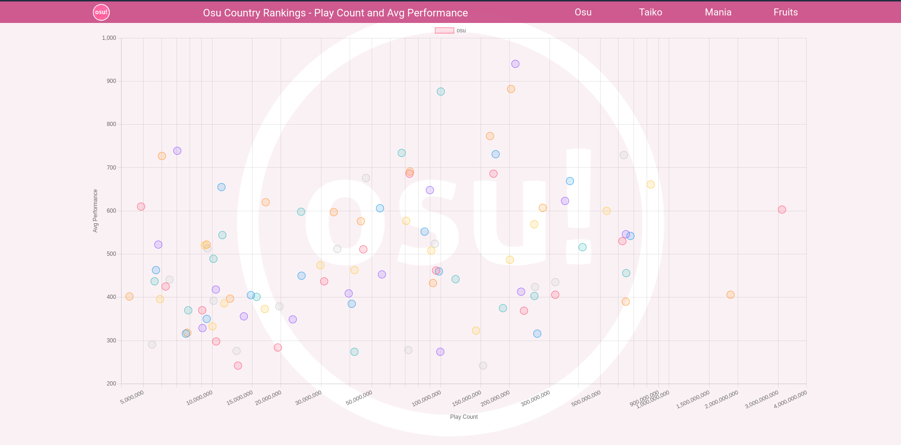
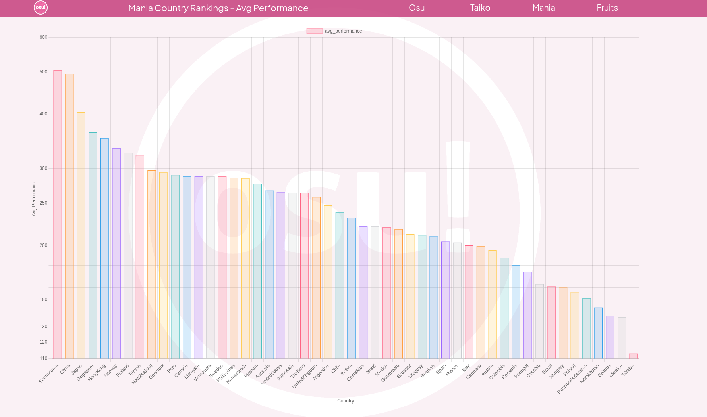

# 🎮 osu! Rankings Crawler

[](https://opensource.org/licenses/MIT)
[](https://www.python.org/downloads/)
[](https://flask.palletsprojects.com/)
[](https://scrapy.org/)

A comprehensive tool for crawling, storing, and visualizing osu! country rankings across all game modes. This project combines a high-performance Scrapy crawler for data collection with a sleek Flask-based web dashboard for analysis.

**🌐 Live Demo:** [osu-rankings-crawler.onrender.com](https://osu-rankings-crawler.onrender.com)  
**📊 Data Source:** [osu! Country Rankings](https://osu.ppy.sh/rankings/osu/country)

---

## ✨ Features

- **Multi-Mode Crawling**: Supports all four osu! game modes: Regular, Taiko, Catch the Beat (Fruits), and Mania.
- **Automated Data Pipeline**: Scrapy-based crawler for efficient data gathering and direct storage into SQLite.
- **Periodic Crawler**: Configurable scheduler for automated, recurring crawls.
- **Interactive Dashboard**:
    - **Dynamic Tables**: Powered by DataTables with real-time filtering, sorting, and pagination.
    - **Visual Insights**: Interactive bar charts for performance metrics and scatter charts for correlation analysis.
- **Responsive UI**: Clean, modern interface built with custom CSS and a Bootstrap-inspired layout.
- **RESTful API**: Internal API endpoint (`/api/country_rankings`) for programmatic access to ranking data.

---

## 📸 Screenshots

### Rankings Table


### Performance Visualization




---

## 🛠️ Tech Stack

- **Backend**: [Python](https://www.python.org/), [Flask](https://flask.palletsprojects.com/)
- **Crawler**: [Scrapy](https://scrapy.org/)
- **Database**: [SQLite](https://www.sqlite.org/)
- **Frontend**: 
    - [Chart.js](https://www.chartjs.org/) (Data Visualization)
    - [DataTables](https://datatables.net/) (Interactive Tables)
    - [Axios](https://axios-http.com/) (API Requests)
    - [jQuery](https://jquery.com/)

---

## 📁 Project Structure

```text
.
├── main.py              # Flask Web Application entry point
├── crawl_all.py         # Batch crawler script for all game modes
├── init_db.py           # Database initialization script
├── config.py            # Global configuration and constants
├── osu_crawler/         # Scrapy project directory
│   ├── spiders/         # Crawler logic
│   └── scrapy.cfg       # Scrapy configuration
├── schema/              # SQL schema files for each mode
├── static/              # CSS, JS, and Image assets
└── templates/           # Jinja2 HTML templates
```

---

## 🚀 Getting Started

### Prerequisites
- Python 3.8 or higher
- `poetry` or `pip` (Python package manager)

### Installation

1. **Clone the project**
   ```bash
   git clone https://github.com/JiaLong0209/osu-rankings-crawler.git
   cd osu-rankings-crawler
   ```

2. **Install dependencies**

   **Using Poetry (Recommended):**
   ```bash
   poetry install
   ```

   **Using pip & Virtual Environment:**
   ```bash
   python -m venv venv
   source venv/bin/activate  # On Linux/Mac
   # venv\Scripts\activate  # On Windows
   pip install -r requirements.txt
   ```

3. **Initialize the Database**
   Generates a new `osu.db` and applies the schema for all modes.
   ```bash
   # If using Poetry: poetry run python init_db.py
   python init_db.py
   ```

4. **Crawl the Rankings**
   Runs the crawler to populate the database.
   ```bash
   # If using Poetry: poetry run python crawl_all.py
   python crawl_all.py
   ```

### Running the Web Server

**For development/debugging:**
```bash
python main.py --debug
```

**For production (local):**
```bash
python main.py
```
Open [http://127.0.0.1:8000](http://127.0.0.1:8000) (default) to view the rankings.

---

## ⚙️ Configuration (osu_crawler/config.py)

You can customize the crawler behavior by editing `osu_crawler/config.py`:

- **`CRAWL_INTERVAL_MINUTES`**: 
    - `0` (default): Manual mode. Runs once and exits.
    - `> 0`: Periodic mode. Runs the crawler every X minutes.
- **`ENABLE_BACKUP`**: 
    - `True` (default): Automatically creates a single rotation backup of `osu.db` in the `backups/` folder (named `osu.db.bak`) before each new crawl cycle.
- **`END_PAGE`**: Number of ranking pages to crawl (each page contains 50 countries).

---

## 🏛️ Architecture Overview

The project follows a decoupled 3-tier architecture:

1.  **Crawler Layer (Scrapy)**: Fetches raw HTML from the osu! website, parses country data, and inserts it into the SQLite database.
2.  **Storage Layer (SQLite)**: Persisted ranking data including `active_users`, `play_count`, `avg_score`, and `performance`.
3.  **Web Layer (Flask)**: Serves the dashboard UI and provides an API endpoint to supply data to the frontend charts and tables.

---

## 📚 References

- [Scrapy Documentation](https://docs.scrapy.org/)
- [Flask & SQLite Integration](https://www.digitalocean.com/community/tutorials/how-to-use-an-sqlite-database-in-a-flask-application)
- [Chart.js Documentation](https://www.chartjs.org/docs/latest/charts/bar.html)
- [DataTables Documentation](https://datatables.net/)

---

## 📄 License

This project is licensed under the MIT License - see the [LICENSE](LICENSE) file for details.
